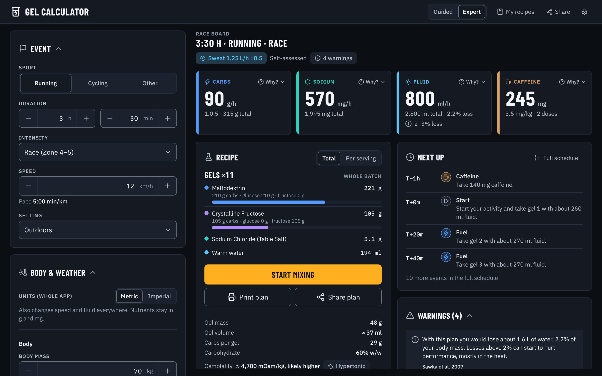
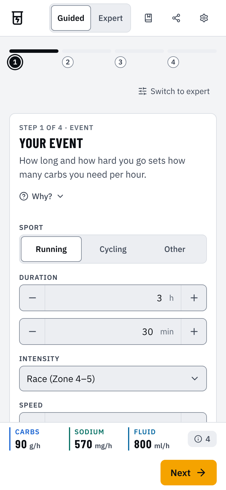
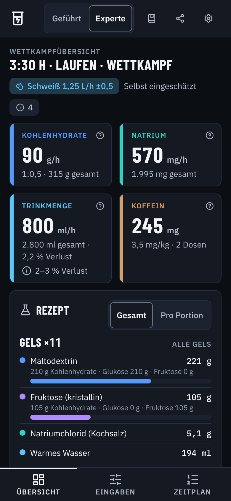

# Gel-Calculator 🧪⚡

A web application designed for endurance athletes to calculate personalized energy gel or drink mix recipes. Determine the right mix of carbohydrates (controlling the glucose-to-fructose ratio), electrolytes and water based on your activity, the conditions and your sweat rate. In English and German, in metric or imperial units.

**Live App:** [https://eikekarbe.com/gel-calculator](https://eikekarbe.com/gel-calculator)



## Key Features

* **Race Board:** Everything for race morning on one board: the event, your sweat rate, four big targets (carbs g/h, sodium mg/h, fluid ml/h, caffeine mg), the recipe with a bar per ingredient, "Start mixing", "Print", "Share", the next schedule items and every warning.
* **Guided Mode:** First time here? Four short steps (event, body & weather with your sweat, the ingredients in your pantry, then your plan), one question at a time on a phone, with a dock that shows your live targets. Switch to expert mode at any step and keep everything you entered.
* **Expert Mode:** All settings in collapsible sections next to the race board on a desktop, or behind a Board / Setup / Schedule tab bar on a phone.
* **German and English, Metric and Imperial:** Switch the language (Deutsch or English), the units (kg, cm, °C, km/h, ml or lb, ft/in, °F, mph, fl oz; carbs and sodium stay in g and mg) and the currency of the cost estimate (€, $, £) in Settings. Numbers use the language's format (1.710 mg, 1,25 L/h in German). The first visit picks them from your browser language.
* **Accessible:** Works with the keyboard and screen readers, with visible focus, large touch targets, "Why?" disclosures instead of hover tooltips, warnings that never rely on colour alone, and AA contrast in both themes.
* **Evidence-Based Targets:** Carbohydrate (g/h), glucose:fructose ratio, sodium (mg/h) and fluid (ml/h) are recommended from your duration, intensity and sweat rate. Each shows its range and a "Why?" explanation with links to the studies, and each can be adjusted by hand.
* **Sweat Rate Three Ways:** Enter a sweat test (body mass before and after, fluid and urine), use a heat-balance estimate from your sport, speed or power, body size, temperature, humidity, sun and air flow, or pick a self-assessed preset. A test can be scaled to race-day conditions.
* **Body-Mass Projection:** See how much water you will lose (or gain) and what the scale will show after the activity, with warnings above 2–3% loss and for any gain.
* **One Ingredient List:** Pick powders and syrups (maltodextrin, dextrose, fructose, sucrose, honey, maple syrup and more), give each a preference weight, or add your own ingredient from its label. The calculator finds the amounts that hit the ratio and shows which ratios your ingredients can make.
* **Electrolytes:** Potassium, magnesium and calcium are optional. Let the calculator choose table salt, sodium citrate or a mix, or enter your own salt amounts in grams, including salts typed in from a label.
* **Gel, Drink or Both:** Choose the gel consistency (isotonic-style, liquid, standard, thick) or the bottle size. The recipe includes the water to add, the volume per gel or bottle and an osmolality estimate with a tonicity chip, and warns when a drink is too strong or a gel needs water.
* **Caffeine & Sodium Bicarbonate:** Optional dose plans with safety limits, including caffeine tablets added to specific gels.
* **Templates:** Start from the ratio, sources and sodium of eight commercial gels, with label sources (from My recipes).
* **Safety Warnings:** Clear warnings when a value goes beyond the studied or recommended range.
* **Total / Per Serving View:** Toggle the recipe between amounts for the whole activity and per gel or bottle.
* **Mixing Instructions:** Step-by-step mixing for each gel batch and drink bottle.
* **Autosave & My Recipes:** Your plan is saved in the browser as you go. Save named recipes, then open, rename, duplicate, delete or share them.
* **Print / Save as PDF:** A clean printout with the plan summary, recipe, mixing steps, schedule, warnings and references.
* **Light & Dark Mode:** Follows your system, or pick one in Settings.
* **Phone First:** From 360 px phones to wide desktops, with a bottom tab bar on phones.

## Getting Started

Prerequisite: Node.js 24 (current LTS; CI builds with it). Follow these steps to set up and run the project locally:

1. **Clone the repository:**

    ```bash
    git clone https://github.com/ekarbe/gel-calculator.git
    cd gel-calculator
    ```

2. **Install dependencies:**

    ```bash
    npm install
    # or
    # yarn install
    # or
    # pnpm install
    # or
    # bun install
    ```

3. **Run the development server:**

    ```bash
    npm run dev
    # or
    # yarn dev
    # or
    # pnpm dev
    # or
    # bun dev
    ```

4. **Open your browser:**
    Navigate to [http://localhost:3000/gel-calculator](http://localhost:3000/gel-calculator)

The main application page is located at `src/app/page.jsx`.

5. **Run the checks** (CI runs the same before every deploy):

    ```bash
    npm run lint
    npm test -- --run
    npm run build                     # static export to ./out
    npx playwright install chromium webkit   # once
    npm run test:e2e                         # end-to-end tests against ./out
    ```

    The end-to-end tests run on a desktop and a phone viewport in Chromium: the guided flow, the race board, German and imperial units, the keyboard and the dialogs, axe accessibility checks in light and dark, guided and expert, English and German, the layout from 360 to 1440 px and the print view. The dialog and focus checks in `e2e/ios.spec.js` (tagged `@webkit`) also run on an iPhone 17 in WebKit (Safari's engine).

    To use a Chromium you already have, set `PW_CHROMIUM_EXECUTABLE=/path/to/chromium` for `npm run test:e2e`. Without WebKit, run `npm run test:e2e -- --project chromium --project mobile`.

6. **Refresh the images** after a UI change: `node scripts/render-images.mjs` renders the social preview card (`public/og.png`) and the screenshots in this README from `./out` (build first; `PW_CHROMIUM_EXECUTABLE` works here too).

## How It Works

On your first visit the app opens in **guided mode**: four steps, then your race board. Later visits open in **expert mode**, which shows every setting next to the board. The header switches between the two, and holds My recipes, Share and Settings (theme, language, units, currency).

1. **Activity Basics:** Enter the duration (hours and minutes), intensity and sport. Running takes your speed (the pace is shown), cycling your power (or the speed, from which the power is estimated), other sports an effort in METs. Add your body mass (kg or lb), height (cm or ft and in) and whether you are heat acclimatised, then the temperature (°C or °F), humidity, setting (outdoors, indoors with or without a fan) and sun. The calculator picks a carbohydrate target from the duration and places it by intensity. For example, 3 h at moderate intensity gives 75 g/h in a 60–90 g/h range, and 1 h gives 15 g/h or a mouth rinse. Events under 45 min need no carbs, so the plan has no gels. Events over 2.5 h offer a "Gut-trained" option for 90–120 g/h.
2. **Why? and Adjust:** The carb target, ratio, sodium and fluid each show the recommended value, the evidence range and a "Why?" button that explains the rule and links to the studies. Switch to **Adjust** to set your own value. You still get the same safety warnings.
3. **Caffeine and bicarbonate (optional):** Turn on caffeine (1–6 mg/kg) for a pre-race dose and, in longer events, late doses. The plan keeps caffeine in your body under 6 mg/kg. "Add to gels as tablets" puts the in-race doses into specific gels as half or whole 100 or 200 mg tablets. Sodium bicarbonate is meant for short, hard events; for events over 90 min it sits behind a "Show" link.
4. **Sweat rate:** Choose **Test**, **Estimate** or **Presets**. A sweat test uses your body mass before and after a session, what you drank and any urine, corrected for the mass you lose by burning fuel. With "Scale the test to this event" on, the heat-balance model scales your measured rate by how much it predicts the race conditions change it (0.5 to 2 times); a test in the race's own conditions keeps your measured rate. The estimate works out the heat your body must lose by sweating (typical error ±0.5 L/h) and warns when the heat cannot be lost at all. In cool weather it can predict almost no sweat, because it assumes light race kit and a steady pace: the app then says so and suggests drinking to thirst or a sweat test. Your saltiness preset gives the sweat sodium for every source.
5. **Electrolytes & Hydration:** Sodium starts at about half your estimated sweat sodium loss, within the guideline range for the duration. Fluid is about 80% of your sweat loss and at most 800 ml/h, so you never plan to drink more than you sweat. Next to the fluid target you see the projected change on the scale and the water deficit as a share of body mass. Potassium, magnesium and calcium are optional under "Advanced". Salts are worked out for you (table salt, sodium citrate or a mix), or you can enter your own amounts in grams and add salts from a label.
6. **Carb Ratio and Ingredients:** The glucose:fructose ratio follows your carb target: 1:0.5 up to 90 g/h, rising to 1:0.8 at 120 g/h. Up to 60 g/h glucose alone also works. Add ingredients to one list and set a weight for each: the calculator keeps the amounts as close to your weights as the ratio allows. A bar shows which ratios your ingredients can make, and you get a warning when they cannot make the target. Custom ingredients take their carbs per 100 g and fructose share from the label.
7. **Recipe:** Under "Format" pick a gel, a drink or both, the gel consistency, the bottle size and the drink's share of the carbs. The race board lists each part's ingredients and the water to add, for the whole activity or per gel or bottle, with the gel mass and volume or the bottle fill, the osmolality and any warnings. With 0 gels per hour (or no carbs for gels) everything goes into the drink, and the drink's strength and osmolality checks cover all of it. It shows a rough cost in your currency, opens step-by-step mixing instructions ("Start mixing") and prints a clean black-on-white copy ("Print plan", or save it as a PDF).
8. **Race Board and Schedule:** The board's four tiles show the carb, sodium, fluid and caffeine targets with their totals, the ratio and the projected body-mass change, each with a "Why?". The chips above them show your sweat rate with its source and uncertainty and the number of warnings. "Next up" shows the first schedule items; the full schedule (as a list or a table) lists every gel, drink sip, caffeine and bicarbonate dose with its time (T−1h 30m, T+20m, …).
9. **Templates:** In "My recipes", "Start from a gel template" loads the sugar ratio, carb sources and sodium salt of a commercial gel (GU, Honey Stinger, Maurten, BPN, SiS, Precision Fuel & Hydration, GU Roctane, UnTapped). Your carb and sodium targets stay the same. Each template links to its label sources and says whether every value was verified.
10. **Saving and sharing:** Your inputs are autosaved in this browser and come back when you reload; so do your language, units, currency, theme and mode. "My recipes" saves named plans you can open, rename, duplicate, delete or copy as a link. Share a link that restores your inputs (each person keeps their own language and units), or download an image of the recipe. Links from the previous version (v3) still open; older links cannot be loaded, and the app says so.

See [CORE.md](CORE.md) for every rule, number and citation.

## Screenshots

| Guided mode on a phone | The race board in German, dark theme |
| --- | --- |
|  |  |

The screenshots show a 3:30 h race run with a self-assessed sweat rate of 1.25 L/h and caffeine.

## Configuration & Data

* **Ingredients:** Carbohydrate sources (carbs per gram, glucose/fructose split, osmoles per gram, water content, powder or syrup) and salts (ion shares, osmoles per gram) are defined in `src/constants/constants.js`. Salt ratios are the ion's share of the salt **as sold**, including hydrate water (e.g. Epsom salt is the heptahydrate), so check that the form named in the app matches your product. There are no absorption factors: targets are amounts you take in, as guidelines state them.
* **Sweat presets:** The six sweat rates, six sweat sodium levels and their descriptions are in the same file.
* **Templates:** Commercial gel data, with label source links, the month checked and a `verified` flag, is in `src/constants/templates.js`.
* **Rules:** Each topic has a pure module in `src/domain/` (`carbs`, `solver`, `heatBalance`, `sweat`, `hydration`, `electrolytes`, `concentration`, `caffeine`, `bicarbonate`, `schedule`, `recipe`). Thresholds are named constants in each module. `src/domain/plan.js` holds the input defaults and limits (`DEFAULT_INPUTS`, `INPUT_LIMITS`) and `computePlan`, which builds the whole plan the UI shows.
* **Evidence:** The citation registry (authors, year, title, journal, DOI) is `src/domain/evidence.js`.
* **Text:** Every string, from explanations and warnings to button labels, is a message key. The English text is in `src/i18n/en/<namespace>.js`, the German in `src/i18n/de/<namespace>.js` (domain modules plus `ui-*` catalogs per UI area); a test keeps both with the same keys and placeholders. Placeholders such as `{ml:volume}` convert to the chosen units.
* **Units and cost:** Unit conversions are in `src/domain/units.js` (the plan always stores metric values), the rough cost per currency in `src/domain/cost.js`.
* **Design:** Colour, type and spacing tokens for the light and dark themes are in `src/app/globals.css`; `scripts/check-contrast.mjs` checks their contrast (it runs with `npm test`). UI building blocks are in `src/components/ui/`.
* **State:** `src/state/` holds the plan provider (with the autosave), the UI provider and its prefs (language, units, currency, mode), the share link codec (version 4; version 3 links are migrated, older links are not loaded and the app tells the visitor) and the browser storage (`localStorage` keys `gel-calculator:autosave`, `gel-calculator:recipes` and `gel-calculator:prefs`).

## Contributing

Contributions, issues, and feature requests are welcome! Feel free to check the issues page or submit a pull request.

## License

See the [LICENSE](LICENSE.md) file for license rights and limitations (GPLv3).

    Gel-Calculator - Personalized fuel calculator for endurance athletes.
    Copyright (C) 2026  Eike Christian Karbe

    This program is free software: you can redistribute it and/or modify
    it under the terms of the GNU General Public License as published by
    the Free Software Foundation, either version 3 of the License, or
    (at your option) any later version.

    This program is distributed in the hope that it will be useful,
    but WITHOUT ANY WARRANTY; without even the implied warranty of
    MERCHANTABILITY or FITNESS FOR A PARTICULAR PURPOSE.  See the
    GNU General Public License for more details.

    You should have received a copy of the GNU General Public License
    along with this program.  If not, see <https://www.gnu.org/licenses/>.

## Acknowledgements

* Built by Eike Christian Karbe.